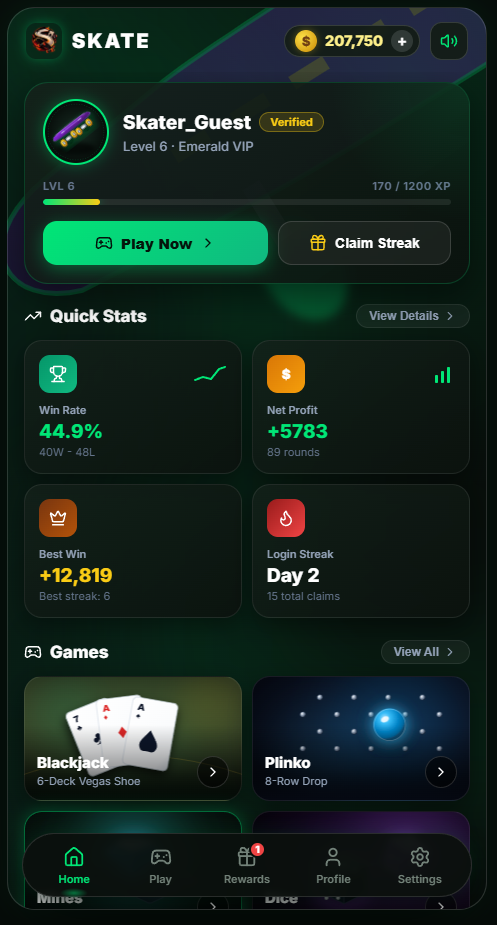
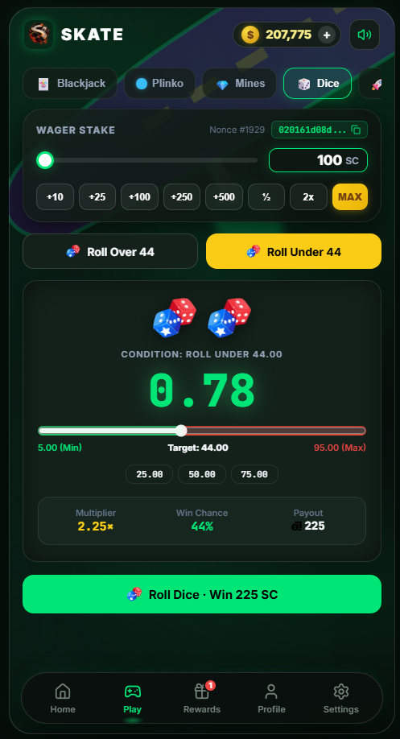
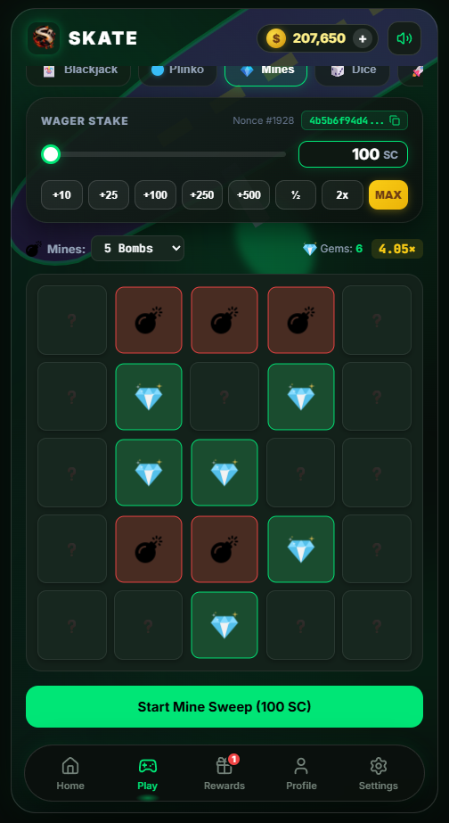
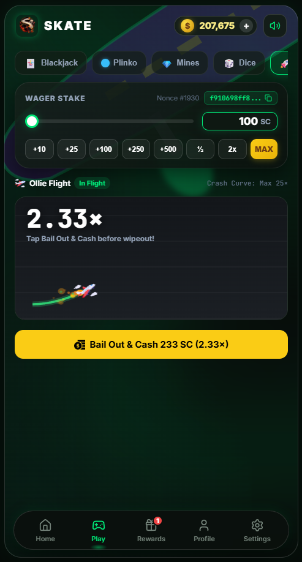

<div align="center">

  

  # 🛹 SKATE
  ### *Luxury Emerald Casino & Provably Fair Arcade*

  [⬇️ Download Android APK (SKATE.apk)](#-download--installation) • [✨ Features](#-key-features) • [🎮 Games Catalog](#-game-modes) • [🛡️ Provably Fair](#-provably-fair-engine) • [🚀 Quickstart](#-getting-started)

</div>

---

## 📱 App Screenshots

<div align="center">
  <table>
    <tr>
      <td width="25%" align="center">
        <b>Home Lobby</b><br/>
        
      </td>
      <td width="25%" align="center">
        <b>Royale Blackjack</b><br/>
        
      </td>
      <td width="25%" align="center">
        <b>Daily Rewards & Streak</b><br/>
        
      </td>
      <td width="25%" align="center">
        <b>VIP Career Profile</b><br/>
        
      </td>
    </tr>
  </table>
</div>

---

## 🏆 Win & Lose Celebration Modals

Whenever a game round resolves, custom full-screen celebration modals pop up with hardware haptic pulses, radial lighting, and artwork:

<div align="center">
  <table>
    <tr>
      <td width="50%" align="center">
        <h3 style="color: #00e676;">🎉 YOU WIN!</h3>
        <br/>
        <sub>Royal Crown, gold chips, spade jewel, dynamic payout chip badge & neon emerald CTA.</sub>
      </td>
      <td width="50%" align="center">
        <h3 style="color: #ef4444;">💥 YOU LOSE</h3>
        <br/>
        <sub>Cracked ace of spades, crimson embers, shattered chips, streak motivation & neon red CTA.</sub>
      </td>
    </tr>
  </table>
  <p><sub>*Popups include a <b>"Turn Off Popup"</b> button redirecting directly to Settings to toggle celebration modals on or off.*</sub></p>
</div>

---

## ✨ Key Features

- **🎨 Dark Emerald Luxury Aesthetic**: Tailored color palette (`#070d0a`, neon emerald `#00e676`, metallic gold `#facc15`, crimson `#ef4444`), glassmorphism, dynamic glowing chips, and zero-clutter typography.
- **📱 True Native Android Experience**:
  - **Zero Scrollbars**: Webkit, Firefox, and Android WebView scrollbar indicators are disabled globally for an app-store native feel.
  - **Floating Dock Navigation**: Floating pill bottom navigation bar with active glowing indicators.
  - **Page Transition Effects**: Route-keyed slide-and-fade page transitions with automatic scroll-to-top resets.
- **📳 OS Hardware Vibration Bridge**:
  - Direct Android Java `Vibrator` / `VibrationEffect` bridge (`AndroidHapticsBridge`) bypassing browser gesture limitations.
  - Dynamic multi-burst victory rhythms (heavy triple pulse on big wins $\ge 2\times$).
  - Visual stage screen-rumble with radial emerald flash.
- **🔔 Phone Re-Engagement Notifications**:
  - High-priority Android notification channel (`skate_casino_channel`) with vibration and custom app icon.
  - Attractive lock-screen alerts bringing users back to claim daily vaults, hot blackjack streaks, or multiplier alerts.
  - Background listener scheduling alerts when the user minimizes the app.
- **💰 Stake Controls (10–5,000 SC)**:
  - Direct custom numeric typing in betting amount box.
  - Dynamic stake slider scaling automatically to user balance, capped at the table limit.
- **🔑 Admin Virtual Credits Injection (env-gated)**:
  - Credit grant tool in Settings, enabled only when a `VITE_ADMIN_KEY` is configured at build time. No key is committed to the repo.
  - Transaction ledger history and balance synchronization.

---

## 🎮 Game Modes

| Game | Type | Core Mechanics | Max Potential |
| :--- | :---: | :--- | :---: |
| **Royale Blackjack** | Table Felt | 6-Deck Vegas Shoe, Dealer hits soft 17, Split Hands, Double Down, Surrender, 2:1 Insurance, 3:2 Natural Blackjack payout. | $2.5\times$ |
| **Skate Plinko Drop** | Physics Luck | 8-row binomial peg drop path. Switchable Low/High risk volatility with 9 bucket multipliers. | Up to $15.0\times$ |
| **Emerald Mines** | Grid Strategy | $5\times 5$ minefield (1 to 24 configurable bombs). Progressive multiplier safe gem uncovering with cash-out anytime. | Over $100\times$ |
| **Neon Dice 100** | Pure Probability | Provably fair roll generator ($0.00 - 100.00$). Dynamic Over/Under slider with real-time win probability and multiplier calculation. | Up to $99.0\times$ |
| **Ollie Crash** | Multiplier Curve | Skater multiplier rocket curve. Cash out before the skater wipes out! Real-time acceleration. | Uncapped |
| **Precision Grind** | Reflex Arcade | High-speed oscillating grinding cursor. Hit the emerald green zone or bullseye gold center to multiply stake. | Up to $5.0\times$ |

---

## 🛡️ Provably Fair Engine

Game outcomes are derived deterministically from `ServerSeed:ClientSeed:Nonce`, so any round can be re-checked with the built-in verifier in **Settings**.

Be honest about the limits before calling this audited fairness:

1. **Server Seed**: generated in-browser per session; the user can rotate it in Settings (nonce resets to 1).
2. **Client Seed**: user-customizable string, editable anytime in **Settings**.
3. **Nonce**: incrementing counter for every wager placed.
4. **The in-browser hash is not vetted SHA-256.** The fairness display uses a small deterministic hash function (`simpleSha256Hex` in `skate-ui/src/store.js`). The Python backend validator (`skate_backend_server.py`) uses real HMAC-SHA256, but the frontend does not call it yet — the app currently runs entirely in the browser on localStorage. Replacing the in-browser hash with WebCrypto SHA-256 and wiring server-authoritative validation are tracked follow-ups, not current claims.

---

## 📦 Project Architecture

```
skate/
├── .gitignore                      # APKs, databases, node_modules, env files
├── skate_backend_server.py         # Python validation library + self-test (game outcome math)
├── server/                         # FastAPI backend — auth, wallet, games, dummy billing
│   ├── app.py                      # App wiring, CORS, rate limiting, error envelope
│   ├── auth.py                     # JWT tokens, PBKDF2 password checks
│   ├── db.py                       # SQLite schema (extends the validation library's)
│   ├── blackjack.py                # Server-authoritative 6-deck blackjack state machine
│   ├── api.py                      # Auth, wallet, fairness, grant endpoints
│   ├── games.py                    # Game settlement endpoints (all 6 games)
│   ├── billing.py                  # DUMMY payments + subscriptions (no real money)
│   ├── requirements.txt
│   ├── seed_demo.py                # Demo account seeder (demo@skate.app / Demo1234)
│   └── test_api.py                 # End-to-end API checks (34 checks, no pytest needed)
├── ref-imgs/                       # Screenshots and high-res UI artwork
│   ├── icon.png                    # Official SKATE App Brand Icon
│   ├── ss1.png                     # Home Lobby Screenshot
│   ├── ss2.png                     # Rewards & Streak Screenshot
│   ├── ss3.png                     # Royale Blackjack Table Screenshot
│   ├── ss4.png                     # VIP Profile Screenshot
│   ├── win_art.png                 # "YOU WIN!" Modal Artwork
│   └── lose_art.png                # "YOU LOSE" Modal Artwork
└── skate-ui/                       # React 19 Frontend + Capacitor Project
    ├── .env.example                # Documented build-time env vars (no real secrets)
    ├── android/                    # Android Studio Native Project
    │   └── app/src/main/
    │       ├── AndroidManifest.xml # Vibrate & Post-Notifications permissions
    │       ├── java/.../MainActivity.java # Java Haptics & Notification Bridges
    │       └── res/                # Mipmap App Icons (mdpi to xxxhdpi) & splash
    ├── src/
    │   ├── App.jsx                 # App shell, routing, auth guard, server banner
    │   ├── api.js                  # API client (token, error envelope, idempotency)
    │   ├── auth.jsx                # Auth context (login/register/logout, /me)
    │   ├── store.js                # UI state; wallet/ledger synced from the server
    │   ├── notificationService.js  # Android local notifications & catchy alerts
    │   ├── index.css               # Luxury Dark Emerald CSS Design System
    │   ├── components/
    │   │   └── WinLoseModal.jsx    # Pop-up celebration & defeat modal
    │   ├── pages/                  # Home, Play, Rewards, Profile, Settings, History, Login, Subscribe
    │   └── games/                  # Blackjack, Plinko, Mines, Dice, Crash, Reflex
    ├── public/                     # Icons, vectors, sound assets & artwork
    ├── package.json
    └── vite.config.js
```

---

## 🚀 Getting Started

### Prerequisites
- **Node.js** 18+ & **npm**
- **Python** 3.10+ *(for the API server)*
- **Android Studio** & **JDK 21** *(for compiling Android APK)*

### 1. API server (FastAPI + SQLite)

```bash
python -m venv backend-venv
./backend-venv/bin/pip install -r server/requirements.txt

SKATE_SERVER_SECRET=your-secret-here \
SKATE_JWT_SECRET=your-jwt-secret-here \
SKATE_DB_PATH=server/skate.db \
./backend-venv/bin/python -m uvicorn server.app:app --port 8000
```

Interactive docs: [http://localhost:8000/docs](http://localhost:8000/docs). The server is the authority for credits, game outcomes, and the ledger — the frontend never settles a round locally. A demo account can be seeded with `python server/seed_demo.py` (demo@skate.app / Demo1234, play money only). API checks: `python server/test_api.py`.

### 2. Web Application

```bash
cd skate-ui
npm install
npm run dev
```
Open [http://localhost:5173](http://localhost:5173) in your mobile browser or emulator. Set `VITE_API_URL` in `skate-ui/.env` if the API runs elsewhere (default `http://localhost:8000`). Without a reachable API the app shows a banner and does not play for credits.

### 3. Python validation library (standalone self-test)

```bash
SKATE_SERVER_SECRET=your-secret-here python skate_backend_server.py
```

Runs the validation library's self-test: it creates a local dev database and runs every game validator, printing the results. The server secret must come from the environment; there is no committed default.

### 3. Build & Export Android APK

```bash
cd skate-ui

# 1. Build optimized web assets
npm run build

# 2. Sync web assets with Capacitor Android
npx cap copy android

# 3. Compile Android debug APK with Gradle
cd android
.\gradlew.bat assembleDebug

# Output APK:
# android/app/build/outputs/apk/debug/app-debug.apk
```

---

## 📲 Download & Installation

No APK is committed to this repository. Build one from source with the steps above, or grab a published build from GitHub Releases.

- Enable *"Install Unknown Apps"* on your Android device and tap to install.

---

## ⚙️ Configuration & Secrets

| Feature | Key / Command | Description |
| :--- | :--- | :--- |
| **API Base URL** | `VITE_API_URL` (frontend env) | Where the web app reaches the API; default `http://localhost:8000`. |
| **Backend Server Secret** | `SKATE_SERVER_SECRET` (env) | Signs ledger checksums and seeds game validation; no committed default. |
| **JWT Signing Secret** | `SKATE_JWT_SECRET` (env) | Signs login tokens; no committed default. |
| **Server Database** | `SKATE_DB_PATH` (env) | SQLite file for the API; default `server/skate.db`. |
| **Notification Channel** | `skate_casino_channel` | Android notification channel with high priority and vibration. |
| **Provably Fair Seed** | User configurable | Accessible via **Settings > Preferences & Fairness**; the server commits only a hash of its seed and reveals the old seed on rotation, so past rounds stay verifiable. |

## 🧱 Full-stack notes & known limitations

- **Server authority:** credits, game outcomes, and the ledger live on the API. The frontend animates, but every round settles through an idempotent API call — retrying a request can never pay twice.
- **Dummy billing:** payments and subscriptions are fake by design. Checkout takes only a pack/plan id, instantly records a `FAKE-` receipt, and never collects or stores card data. Real billing would need a real provider integration with webhook verification, not card fields bolted onto this module.
- **Scaling path:** the API tier is stateless (JWT auth, DB-held game state) and can scale horizontally, but SQLite is single-writer — moving to Postgres is the documented next step. The in-memory rate limiter is per-process and would move to Redis under multiple workers.
- **Known gaps (honest, not hidden):** Mines minefield placement is still client-side — the server settles on the revealed-gem count at cashout and debits the stake on a bomb hit, but a malicious client could misreport its count; a server-generated minefield with per-reveal validation is the follow-up. Mission/achievement progress is tracked client-side; their credit grants are capped, idempotent, and ledger-auditable, but not yet server-validated. The in-browser fairness display now uses real WebCrypto HMAC-SHA256, matching the server's scheme.

---

<div align="center">
  <sub>Built for performance, fairness, and visual impact. Enjoy responsibly! 🛹♠️</sub>
</div>
