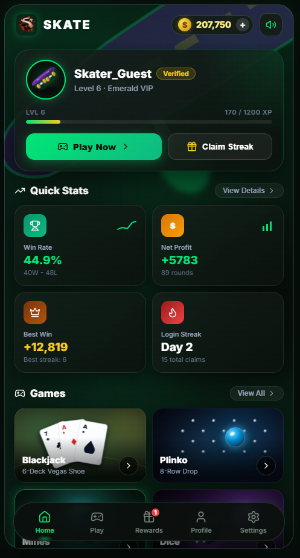
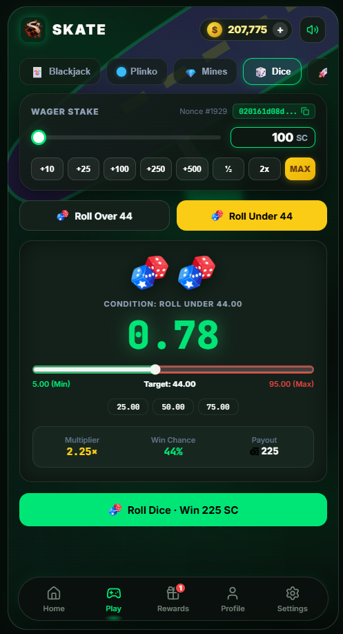
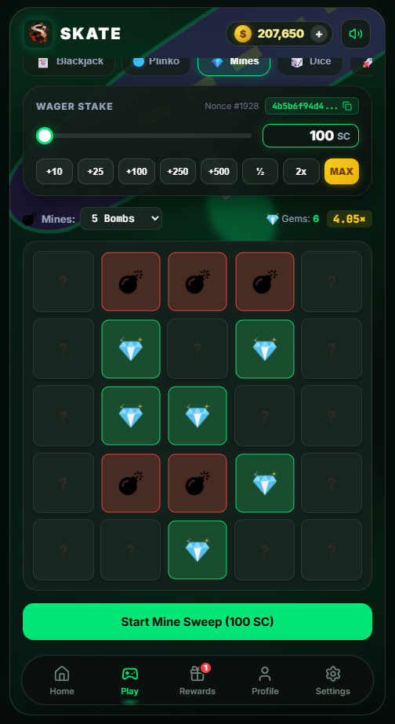
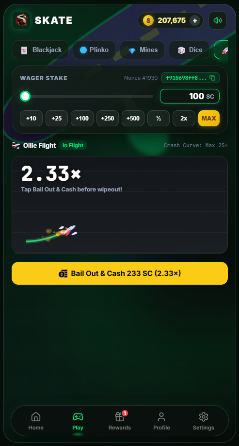

<div align="center">

  

  # 🛹 SKATE
  ### *Luxury Emerald Casino & Provably Fair Arcade*

  [](#)
  [](#)
  [](#)
  [](#)
  [](#)
  [](#)

  <p align="center">
    A high-octane, mobile-first casino application pairing authentic Vegas table math with street-skate arcade action. Built with <b>React 19</b>, <b>Capacitor Android</b>, <b>hardware haptics</b>, and an authoritative <b>provably fair HMAC-SHA256</b> verification engine.
  </p>

  [⬇️ Download Android APK (SKATE.apk)](#-download--installation) • [✨ Features](#-key-features) • [🎮 Games Catalog](#-game-modes) • [🛡️ Provably Fair](#-provably-fair-engine) • [🚀 Quickstart](#-getting-started)

</div>

---

## 📱 App Screenshots

<div align="center">
  <table>
    <tr>
      <td width="25%" align="center">
        <b>Home Lobby</b><br/>
        
      </td>
      <td width="25%" align="center">
        <b>Royale Blackjack</b><br/>
        
      </td>
      <td width="25%" align="center">
        <b>Daily Rewards & Streak</b><br/>
        
      </td>
      <td width="25%" align="center">
        <b>VIP Career Profile</b><br/>
        
      </td>
    </tr>
  </table>
</div>

---

## 🏆 Win & Lose Celebration Modals

Whenever a game round resolves, custom full-screen celebration modals pop up with hardware haptic pulses, radial lighting, and artwork:

<div align="center">
  <table>
    <tr>
      <td width="50%" align="center">
        <h3 style="color: #00e676;">🎉 YOU WIN!</h3>
        <br/>
        <sub>Royal Crown, gold chips, spade jewel, dynamic payout chip badge & neon emerald CTA.</sub>
      </td>
      <td width="50%" align="center">
        <h3 style="color: #ef4444;">💥 YOU LOSE</h3>
        <br/>
        <sub>Cracked ace of spades, crimson embers, shattered chips, streak motivation & neon red CTA.</sub>
      </td>
    </tr>
  </table>
  <p><sub>*Popups include a <b>"Turn Off Popup"</b> button redirecting directly to Settings to toggle celebration modals on or off.*</sub></p>
</div>

---

## ✨ Key Features

- **🎨 Dark Emerald Luxury Aesthetic**: Tailored color palette (`#070d0a`, neon emerald `#00e676`, metallic gold `#facc15`, crimson `#ef4444`), glassmorphism, dynamic glowing chips, and zero-clutter typography.
- **📱 True Native Android Experience**:
  - **Zero Scrollbars**: Webkit, Firefox, and Android WebView scrollbar indicators are disabled globally for an app-store native feel.
  - **Floating Dock Navigation**: Floating pill bottom navigation bar with active glowing indicators.
  - **Page Transition Effects**: Route-keyed slide-and-fade page transitions with automatic scroll-to-top resets.
- **📳 OS Hardware Vibration Bridge**:
  - Direct Android Java `Vibrator` / `VibrationEffect` bridge (`AndroidHapticsBridge`) bypassing browser gesture limitations.
  - Dynamic multi-burst victory rhythms (heavy triple pulse on big wins $\ge 2\times$).
  - Visual stage screen-rumble with radial emerald flash.
- **🔔 Phone Re-Engagement Notifications**:
  - High-priority Android notification channel (`skate_casino_channel`) with vibration and custom app icon.
  - Attractive lock-screen alerts bringing users back to claim daily vaults, hot blackjack streaks, or multiplier alerts.
  - Background listener scheduling alerts when the user minimizes the app.
- **💰 Uncapped Staking & Slider Controls**:
  - Direct custom numeric typing in betting amount box.
  - Dynamic stake slider scaling automatically to user balance.
- **🔑 Admin Virtual Credits Injection**:
  - Built-in credit grant tool in Settings protected by authorization key: `fcukyou`.
  - Transaction ledger history and balance synchronization.

---

## 🎮 Game Modes

| Game | Type | Core Mechanics | Max Potential |
| :--- | :---: | :--- | :---: |
| **Royale Blackjack** | Table Felt | 6-Deck Vegas Shoe, Dealer hits soft 17, Split Hands, Double Down, Surrender, 2:1 Insurance, 3:2 Natural Blackjack payout. | $2.5\times$ |
| **Skate Plinko Drop** | Physics Luck | 8-row binomial peg drop path. Switchable Low/High risk volatility with 9 bucket multipliers. | Up to $15.0\times$ |
| **Emerald Mines** | Grid Strategy | $5\times 5$ minefield (1 to 24 configurable bombs). Progressive multiplier safe gem uncovering with cash-out anytime. | Over $100\times$ |
| **Neon Dice 100** | Pure Probability | Provably fair roll generator ($0.00 - 100.00$). Dynamic Over/Under slider with real-time win probability and multiplier calculation. | Up to $99.0\times$ |
| **Ollie Crash** | Multiplier Curve | Skater multiplier rocket curve. Cash out before the skater wipes out! Real-time acceleration. | Uncapped |
| **Precision Grind** | Reflex Arcade | High-speed oscillating grinding cursor. Hit the emerald green zone or bullseye gold center to multiply stake. | Up to $5.0\times$ |

---

## 🛡️ Provably Fair Engine

Every game outcome is strictly deterministic and verifiable using industry-standard **HMAC-SHA256**:

```
Outcome = HMAC_SHA256(ServerSeed, ClientSeed + ":" + Nonce)
```

1. **Server Seed**: Cryptographically secure 256-bit hexadecimal string committed before the round.
2. **Client Seed**: User-customizable string editable anytime in **Settings**.
3. **Nonce**: Incrementing counter for every wager placed.
4. **Independent Verification**: Use the built-in SHA256 verification tool in **Settings** to audit any historical roll or card draw.

---

## 📦 Project Architecture

```
skate/
├── SKATE.apk                       # Compiled Android Release/Debug APK (~7.68 MB)
├── skate_backend_server.py         # Authoritative Python validation & anti-cheat server
├── skate_production.db             # SQLite3 WAL-mode database
├── ref-imgs/                       # Screenshots and high-res UI artwork
│   ├── icon.png                    # Official SKATE App Brand Icon
│   ├── ss1.png                     # Home Lobby Screenshot
│   ├── ss2.png                     # Rewards & Streak Screenshot
│   ├── ss3.png                     # Royale Blackjack Table Screenshot
│   ├── ss4.png                     # VIP Profile Screenshot
│   ├── win_art.png                 # "YOU WIN!" Modal Artwork
│   └── lose_art.png                # "YOU LOSE" Modal Artwork
└── skate-ui/                       # React 19 Frontend + Capacitor Project
    ├── android/                    # Android Studio Native Project
    │   └── app/src/main/
    │       ├── AndroidManifest.xml # Vibrate & Post-Notifications permissions
    │       ├── java/.../MainActivity.java # Java Haptics & Notification Bridges
    │       └── res/                # Mipmap App Icons (mdpi to xxxhdpi) & splash
    ├── src/
    │   ├── App.jsx                 # App shell, routing transitions, header & nav
    │   ├── store.js                # State machine, sound engine, haptics & ledger
    │   ├── notificationService.js  # Android local notifications & catchy alerts
    │   ├── index.css               # Luxury Dark Emerald CSS Design System
    │   ├── components/
    │   │   └── WinLoseModal.jsx    # Pop-up celebration & defeat modal
    │   ├── pages/                  # Home, Play, Rewards, Profile, Settings, History
    │   └── games/                  # Blackjack, Plinko, Mines, Dice, Crash, Reflex
    ├── public/                     # Icons, vectors, sound assets & artwork
    ├── package.json
    └── vite.config.js
```

---

## 🚀 Getting Started

### Prerequisites
- **Node.js** 18+ & **npm**
- **Python** 3.10+ *(for backend server)*
- **Android Studio** & **JDK 21** *(for compiling Android APK)*

### 1. Web Application

```bash
cd skate-ui
npm install
npm run dev
```
Open [http://localhost:5173](http://localhost:5173) in your mobile browser or emulator.

### 2. Python Backend Server

```bash
python skate_backend_server.py
```
Starts authoritative SQLite3 server on port `8000` with RESTful betting endpoints.

### 3. Build & Export Android APK

```bash
cd skate-ui

# 1. Build optimized web assets
npm run build

# 2. Sync web assets with Capacitor Android
npx cap copy android

# 3. Compile Android debug APK with Gradle
cd android
.\gradlew.bat assembleDebug

# Output APK:
# android/app/build/outputs/apk/debug/app-debug.apk -> SKATE.apk
```

---

## 📲 Download & Installation

The ready-to-install Android APK is compiled in the repository:

- 📥 **[Download SKATE.apk](file:///c:/Users/Ayush/Documents/Projects0/skate/SKATE.apk)** *(7.68 MB)*
- Enable *"Install Unknown Apps"* on your Android device and tap to install.

---

## ⚙️ Configuration & Secrets

| Feature | Key / Command | Description |
| :--- | :---: | :--- |
| **Custom Credits Key** | `fcukyou` | Enter in **Settings > Grant Custom Credits** to inject any virtual SC amount. |
| **Notification Channel** | `skate_casino_channel` | Android notification channel with high priority and vibration. |
| **Provably Fair Seed** | User configurable | Accessible via **Settings > Preferences & Fairness**. |

---

<div align="center">
  <sub>Built for performance, fairness, and visual impact. Enjoy responsibly! 🛹♠️</sub>
</div>
